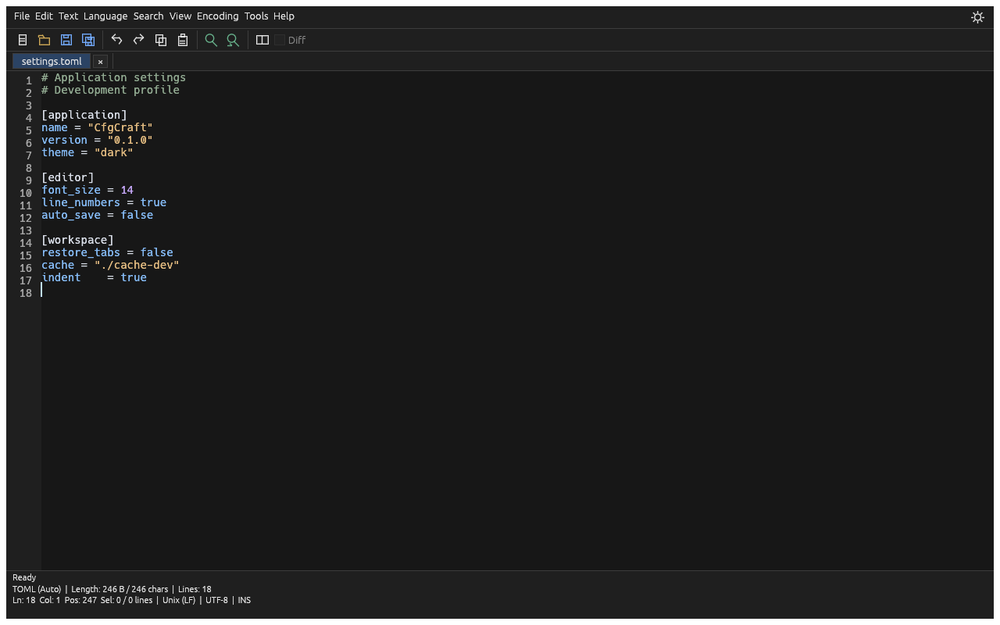
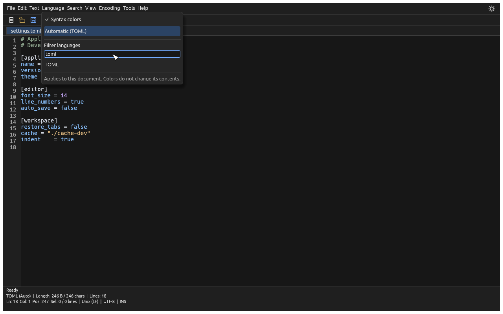
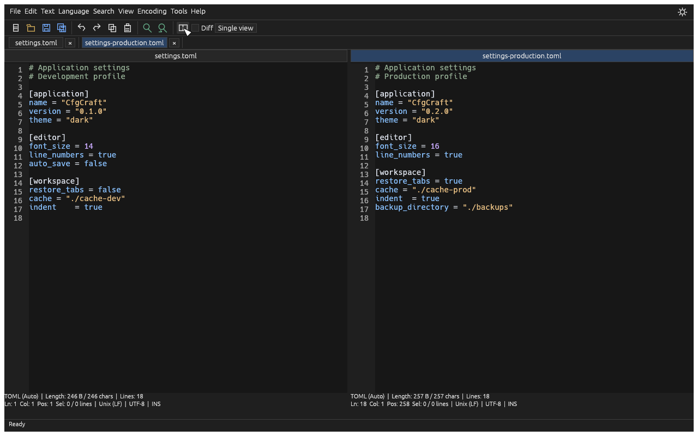
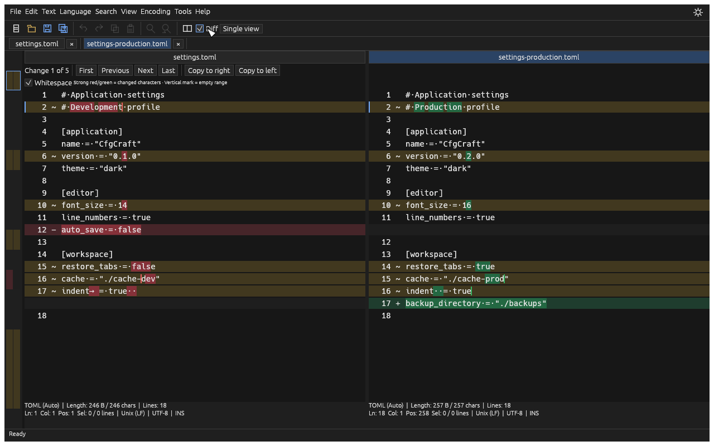
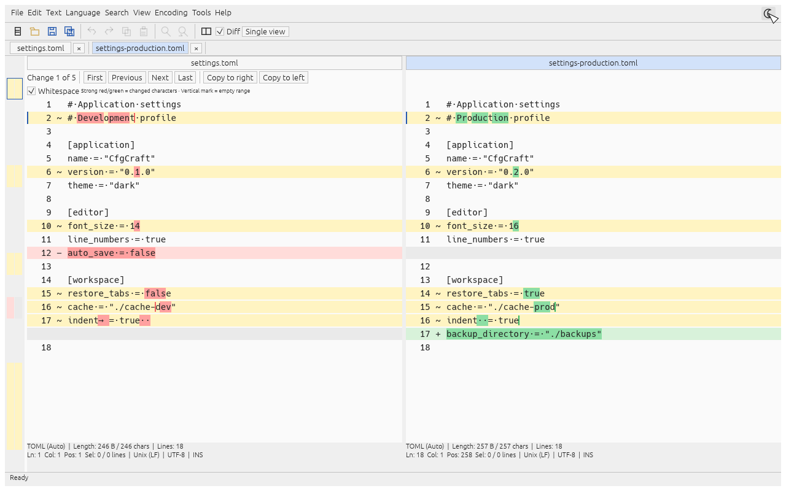
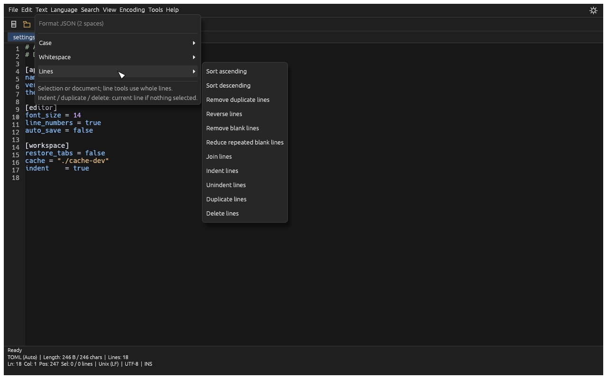
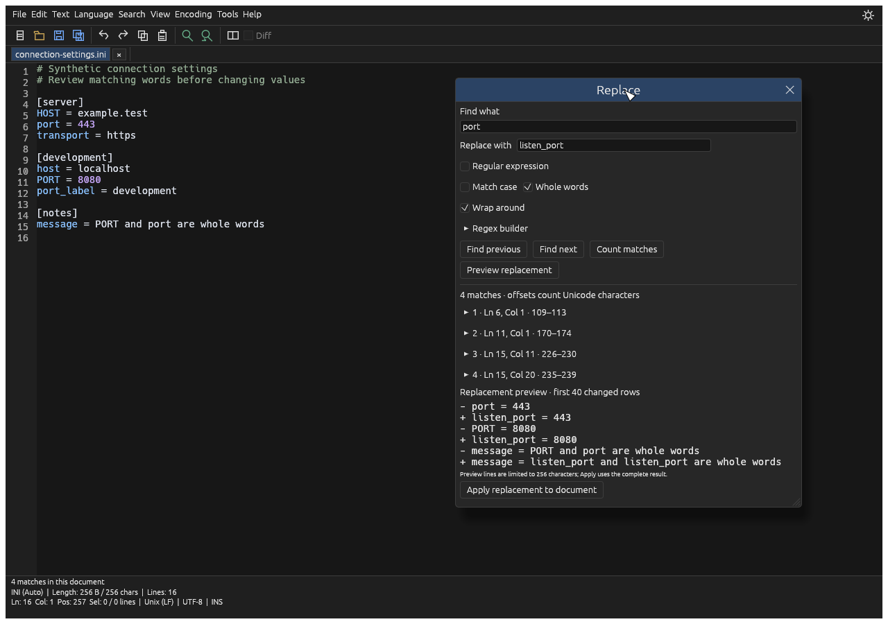
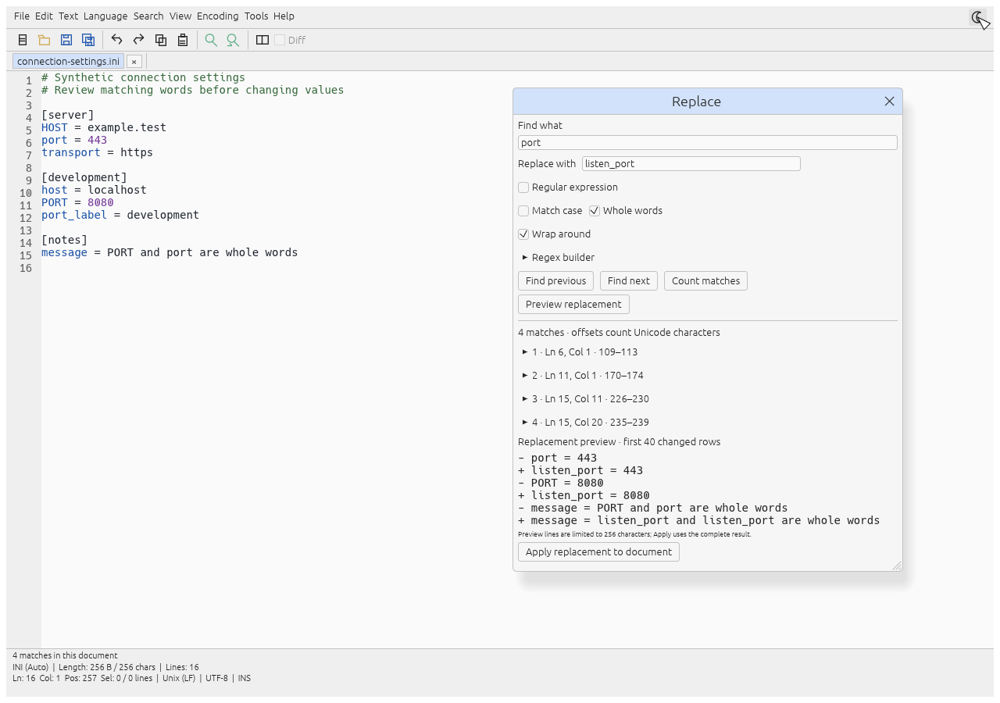

# Craft project media

Public product images for LabDennis Craft project READMEs. Project code and test
fixtures live in their own repositories. Images use generated sample documents.

## CfgCraft development preview

These images render the actual CfgCraft interface, not design mockups. They show
implemented features; they do not imply full Notepad++/WinMerge compatibility or LSP support.

### Editor and language detection

### Split editing and precise comparison

### Text tools

### Search and replace

The original editor includes cursor-based next/previous navigation, case and Unicode
whole-word matching, optional wrap, counting and an undoable replacement preview.

Own screenshots and documentation are available under the MIT license in this repository.
Dependency/font rights are not reassigned. No reference-product screenshots, proprietary
assets, source archives, customer documents or internal work files are included.

Use commit-pinned raw URLs when embedding an image in a versioned README. Add future
projects in their own directories; retain existing image paths for older documentation.
